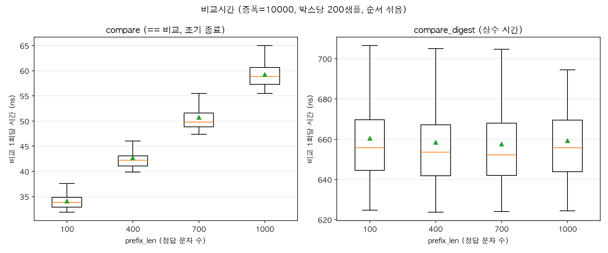

# timing-attack-median

문자열 비교 방식(`==` vs `hmac.compare_digest`)의 **타이밍 공격 취약성**을 측정·확인하는 학습용 프로젝트.

## 왜 있는가

`==`는 첫 불일치 지점에서 바로 멈춘다(early-exit). 그래서 **정답 접두사가 길수록 비교 시간이 늘어나** 비밀 값을 시간으로 흘린다. 공격자는 이 시간 차이를 이용해 비밀을 한 글자씩 복원할 수 있다.

`hmac.compare_digest`는 항상 전체를 비교하는 상수 시간(constant-time) 방식이라 이 정보가 새지 않는다.

이 프로젝트는 그 차이를 실제로 측정해서 눈으로 확인한다.

## 측정 결과

정답 접두사 길이(`prefix_len`)를 바꿔가며 비교 1회당 시간을 측정한 결과:



```
compare (==)
  prefix_len= 100   35.0 ns/op
  prefix_len= 400   43.8 ns/op
  prefix_len= 700   51.2 ns/op
  prefix_len=1000   59.7 ns/op      ← 정답이 길수록 느려짐 (누출)
compare_digest (hmac)
  prefix_len= 100  653.3 ns/op
  prefix_len=1000  651.7 ns/op      ← prefix_len과 무관하게 일정 (안전)
```

- `compare (==)`: `prefix_len`이 커질수록 시간이 계단식으로 증가 → **비밀 정보 누출**
- `compare_digest`: 항상 일정 → **누출 없음**

→ 비밀 값(토큰·HMAC·비밀번호 등) 비교에는 `==` 대신 **`hmac.compare_digest`** 를 써야 한다.

## 참고

위 결과는 노이즈를 제거하고 비교를 반복해 신호를 키우고, 측정 순서를 섞어 교란을 없앤 조건에서 얻은 결과임을 참고.
